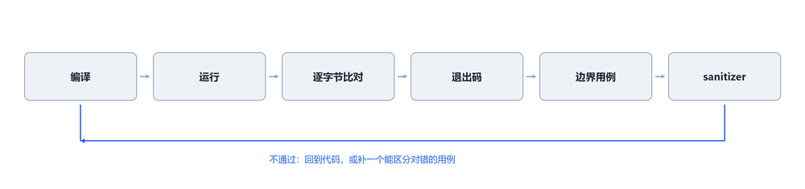
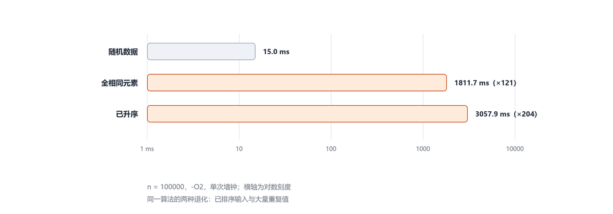

# 技术报告：五道 C/C++ 基础题的实现与验证

本报告记录五道课程练习题的实现过程、涉及的语言与工具技术、仓库文件组织方式，以及实际执行过的命令行操作。所有验证结果均为本机实测。

## 1. 背景与材料来源

五道题来自课程平台，按难度递进：

| 序号 | 题目 | 平台节点名 | 考察重点 |
| --- | --- | --- | --- |
| 一 | 读数统计 | cpp-build-run | 编译、运行、输出契约 |
| 二 | 设备巡检记录 | cpp-program-structure | 字符串、数组聚合、并列规则 |
| 三 | 固定容量读数窗口 | cpp-memory-errors | 环形缓冲、数组边界 |
| 四 | 多文件统计工具 | cpp-multifile-build | 头文件、链接、CMake |
| 五 | 四线程快速排序（可选报告） | cpp-optional-parallel-qsort | pthread、分治并行 |

完成期间平台发生故障，无法获取容器与初始工程。实际拿到的材料只有每题的题面 `README.md` 与 `hints.md`（题目一另有一个 `c/main.c` 起始模板）。因此题目二至题目五均按题面契约从零实现，不是对初始工程的"修复"；测试用例也是依据题面文本重建的。

## 2. 环境与工具清单

宿主为 Windows，编译与运行在 WSL2 的 Ubuntu 中进行（判题在平台侧的 Linux 环境）。

| 用途 | 工具 | 版本 |
| --- | --- | --- |
| 操作系统 | Ubuntu（WSL2） | 26.04 LTS，内核 6.18.33.2-microsoft-standard-WSL2 |
| C 编译器 | gcc | 15.2.0 (Ubuntu 15.2.0-16ubuntu1) |
| C++ 编译器 | g++ | 15.2.0 |
| 调试器 | gdb | 17.1 |
| 构建 | GNU Make / CMake | 4.4.1 / 4.2.3 |
| 版本控制 | git | 2.53.0 |
| 编辑器 | vim / VS Code（WSL Remote） | 9.1 / — |
| 传输与认证 | OpenSSH（ssh/scp） | 9.5p1 |
| 辅助脚本 | python3 | 3.14.4 |
| 对照实验 | Go | 1.26.5 |

宿主侧另有 MinGW GCC 6.3.0 与 gdb 7.6.1，仅在早期本地试编译时使用；由于版本较老（2016 年），最终以 WSL 内 GCC 15.2 为准。

判题环境使用固定命令构建：C 源码用 `gcc -std=c11`，C++ 源码用 `g++ -std=c++17`，不带告警开关。

## 3. 各题流程


### 3.1 题目一：读数统计

- **契约**：读入 `n` 与 `n` 个整数，输出恰好四行 `count= / sum= / min= / max=`，退出码 0。
- **实现**：单遍流式读入，不保存数组。第一个读数同时作为 `sum`、`min`、`max` 的初值，循环从第二个读数开始比较。
- **要点**：`min`/`max` 不能用 0 初始化——0 未必出现在输入里，全正数会让 `min` 卡在 0，全负数会让 `max` 卡在 0。每次 `scanf` 检查返回值。
- **验证**：3 组样例 + 全正、全负、重复值、`n=1`、`n=10000`，逐字节比对输出并单独检查退出码。

### 3.2 题目二：设备巡检记录

- **契约**：读入 `n` 行 `<type> <status> <hours>`，按固定顺序输出四类统计，最后输出 `busiest <type>`；并列时取固定顺序中最靠前的类型。
- **实现**：四个类型映射到下标 0..3，用两个长度 4 的数组分别累加记录数与小时数；输出阶段按数组顺序打印，零记录类型自然输出 `0 0`。
- **要点**：类型名必须用 `strcmp` 整串比较（`scanner` 与 `server` 首字母相同）；并列判断用严格大于 `>` 且从下标 0 扫描，才保证"取靠前"；`scanf("%15s %15s %d")` 限定宽度，防止缓冲区越界。
- **验证**：3 组样例 + 8 个针对性用例（含输入顺序与固定顺序相反的并列、四类全零、`n=1000` 上界）。

### 3.3 题目三：固定容量读数窗口

- **契约**：只保留最后 8 个读数，输出 `kept / oldest / last / sum` 四行，退出码 0。原始版本的缺陷是容量用尽后越界写入。
- **实现**：固定容量环形缓冲。第 `i` 个读数写入 `window[i % CAPACITY]`，`kept` 到 8 后不再增长；窗口绕回后，最早保留值位于"下一个将被覆盖的位置"，即 `window[n % CAPACITY]`；求和只遍历实际保留的 `kept` 个值。
- **要点**：下标恒在 0..7，从根上消除越界；不通过加大数组容量绕过问题（输入上限 100000）。
- **验证**：3 组样例 + 10 个用例（`n=1/2/7/8/9/16/17/100/100000`），并对 `n=9/24/1000/100000` 做 AddressSanitizer + UndefinedBehaviorSanitizer 复跑，零报告。另用"故意还原 `window[i]`"的副本做对照，ASan 报 `stack-buffer-overflow`，证明检测手段有效。
- **调试**：在写入语句处设断点，用 gdb 观察 `i` 与实际下标，确认第 9 个值写入 `window[0]` 而不是 `window[8]`。


### 3.4 题目四：多文件统计工具

- **契约**：工程拆为入口、统计、格式化三部分，用 CMake 构建，可执行目标名必须是 `main`，产物路径 `build/main`；输出四行统计，`sum` 必须用 64 位整数。
- **实现**：`main.c` 调用 `stats_read()`（读入并统计）与 `print_report()`（输出）；`Stats` 结构体字段统一为 `long long`；`CMakeLists.txt` 显式设置 `CMAKE_C_STANDARD 11`、`CMAKE_C_STANDARD_REQUIRED ON` 与 `CMAKE_C_EXTENSIONS OFF`，使编译器实际收到 `-std=c11`；`add_executable` 列出全部三个源文件。
- **要点**：头文件声明与实现文件定义必须逐字一致（C 会在同一源文件内报 `conflicting types`；C++ 会当成重载，最后链接失败）；漏列源文件会在链接阶段报 `undefined reference`。
- **验证**：干净构建 + 3 组样例（含 `sum=5000000000` 超出 32 位、`n=10000` 求和到 `1e13`）；另用临时副本复现两类构建失败，确认失败方式与题面描述一致。

### 3.5 题目五：四线程快速排序（可选报告）

- **契约**：用不超过 4 个工作线程实现快速排序并在退出前全部汇合，不使用 OpenMP/TBB/MPI/CUDA，说明串行截止条件；只需提交 `report.md`，平台不运行程序。
- **实现**：Lomuto 划分，取区间最右元素为基准；划分后较大的一侧交给新线程，较小的一侧留在当前线程；用互斥锁保护的计数器限制工作线程数，抢不到名额直接串行；区间长度不超过 `CUTOFF = 4` 时改用插入排序；在创建线程的那一帧内 `pthread_join` 汇合。
- **数据**：题面给出的 16 个整数内嵌在源码中，验证全部针对这组数据。
- **验证**：排序结果与相邻逆序对检查、与标准库 `qsort` 的 `memcmp` 对照、ThreadSanitizer 零报告、200 组随机种子（`n=500`）压力测试；实跑中题面数据派发 2 个工作线程，各规模下从未超过上限 4。


## 4. 涉及的语法与技术点

### 4.1 C 语言基础

- **预处理与编译单元**：`#include <stdio.h>`、`#include <string.h>` 引入声明；`#define CAPACITY 8` 定义容量常量。
- **类型与声明**：整型 `int`、64 位整型 `long long`；变量必须先声明类型再使用，语句以分号结束。
- **输入输出**：`scanf("%d", &v)` 需要取地址符，返回值表示成功读入的项数；`printf` 的格式占位符 `%d`、`%lld`、`%s` 与换行转义 `\n`。
- **控制结构**：`for`、`while`、`if/else`；C 用花括号划分作用域，缩进不参与语法。
- **模运算用于环回**：`i % CAPACITY` 把线性下标折回固定范围，是环形缓冲的核心。

### 4.2 字符串与字符数组

C 没有字符串类型，"字符串"是**以 `\0` 结尾的 `char` 数组**：

- 字面量 `"router"` 的类型是 `char[7]`（6 个字符 + 结尾 `\0`），在表达式中退化为 `char *`。
- 不能用 `==` 比较内容（比较的是地址），必须用 `strcmp`；整串比较才能区分 `scanner` 与 `server`。
- 没有长度字段，`strlen` 需扫描到 `\0`；数组作为参数传递后退化为指针，`sizeof` 拿不到长度。
- `scanf("%s")` 不检查缓冲区长度，必须用 `%15s` 配合 `char[16]` 这类限宽写法。
- 数组不能整体赋值，复制需要用 `memcpy`。

### 4.3 内存与边界

- 局部变量不初始化时是**不确定值**，读取属于未定义行为；因此"不给初值的 `min`/`max`"必须在任何读取之前先赋值。
- 数组越界在 C 里同样是未定义行为：可能崩溃，也可能静默算错。题目三的正确版本通过取模保证下标恒在范围内。
- 检测手段：AddressSanitizer 在数组周围插入红区，能在越界发生时立即报错并给出行号；UBSan 检测未定义行为。二者需要重新编译（`-fsanitize=address,undefined`）。
- 栈保护（`-fstack-protector-strong`）只保护返回地址，抓不到"同一栈帧内"的越界写；这解释了为什么某些越界只算错、不崩溃。

### 4.4 构建：编译、链接与 CMake

- 单文件：`gcc -std=c11 -Wall -Wextra -o main main.c`。`-std` 指定标准，`-Wall -Wextra` 打开告警（仅本地自查，判题不带）。
- **编译与链接是两个阶段**：编译期错误（`conflicting types`）与链接期错误（`undefined reference`）指向不同原因，前者是声明定义不一致，后者是目标文件缺失。
- CMake：`cmake -S . -B build` 生成构建文件，`cmake --build build` 执行构建；`add_executable(main ...)` 定义目标名，`CMAKE_C_STANDARD` 与 `CMAKE_C_EXTENSIONS OFF` 决定编译标准开关（默认会是 `-std=gnu11`，关闭扩展后才是 `-std=c11`）。

### 4.5 并发：pthread

- `pthread_create` 创建线程并执行入口函数，参数通过 `void *` 传递；`pthread_join` 等待线程结束并回收资源。
- 共享计数器必须用互斥锁保护，否则并发自增会产生竞争。
- 分治并行采用 fork-join 结构：创建者在同一帧内完成自己那部分工作后 join 子线程；子线程再递归创建，形成树形汇合，保证主线程返回时所有后代线程都已结束。
- 竞态检测：ThreadSanitizer（`-fsanitize=thread`）在运行时报告数据竞争；Go 的 `-race` 是同类工具。
- 与 Go 的对照：goroutine 由运行时在工作线程上多路复用，初始栈约 2 KB 且可增长；pthread 是 1:1 内核线程，默认栈 8 MB（本机 `ulimit -s` = 8192 KB，`threads-max` = 62296）。同样的分治快排，在 Go 里可以不数线程直接派发（实测 `n=100000` 派发 99,196 个 goroutine 仍正常完成），在 C 里必须显式限制线程数量与汇合时机。

### 4.6 验证方法



- **逐字节比对**：把期望输出固化为文件，用 `diff`（或进程替换 `diff <(cmd) expected`）比较，比肉眼观察可靠。
- **退出码检查**：题面把"退出码必须为 0"作为独立要求，需单独验证，不能只看输出。
- **边界枚举**：规模上下界（`n=1`、`n` 上限）、取值上下界、并列、重复、全正/全负、零记录。
- **随机压力**：固定种子序列批量运行，覆盖划分形状；题目五用 200 组种子。
- **sanitizer**：ASan/UBSan 查内存与未定义行为，TSan 查数据竞争。
- **缺陷复现对照**：保留一个"故意写错"的副本来验证检测手段确实有效（题目三、题目四各做过一次）。

## 5. 文件与目录组织

仓库按题目分目录，每个目录自成一个可独立构建运行的程序：

```text
ncuscc-work/
├── README.md                                  仓库总说明（目录结构、环境、各题说明与验证）
├── REPORT.md                                  本报告
├── .gitignore                                 忽略编译产物（main、*.o、*.exe、build/）
└── src/
    ├── reading-stats/                         题目一
    │   └── main.c
    ├── device-inspection/                     题目二
    │   └── main.c
    ├── reading-window/                        题目三
    │   └── main.c
    ├── multifile-stats/                       题目四（多文件 + CMake）
    │   ├── CMakeLists.txt
    │   ├── main.c
    │   ├── stats.h
    │   ├── stats.c
    │   ├── format.h
    │   └── format.c
    └── parallel-qsort/                        题目五（源码留档 + 报告）
        ├── qsort_threads.c
        └── report.md
```

组织原则：

1. **一题一目录**，避免入口文件与宏定义互相干扰；题目四的构建入口 `CMakeLists.txt` 就放在该题目录内，提交平台时以该目录作为工作区根目录。
2. **编译产物不入库**：`.gitignore` 忽略 `main`、`*.o`、`*.exe` 与 CMake 的 `build/`，仓库只保留源码与文档。
3. **与判题工作区区分**：平台要求提交工作区根目录下恰好一个 `main.c` 或 `main.cpp`（同时存在两个会返回 `SOURCE_MISSING`），仓库的分目录结构只用于留档，提交时把对应文件复制为工作区根目录的入口。
4. **样例不单独建目录**：题面样例较少且需要逐字节比对，统一在 README 与报告中给出可复制的命令与期望输出，避免样例文件与代码版本脱节。

## 6. 命令行与工具操作记录

以下命令均为实际执行过的操作（WSL 的 Ubuntu 终端内）。`$` 表示 shell 提示符。

### 6.1 环境准备

```bash
$ wsl -d Ubuntu                       # 从 Windows 进入 WSL
$ sudo apt update && sudo apt install -y gdb
$ gcc --version && g++ --version       # 15.2.0
$ cmake --version                      # 4.2.3
$ gdb --version                        # 17.1
```

### 6.2 编译与运行

```bash
# 单文件题目
$ gcc -std=c11 -Wall -Wextra -o main src/reading-stats/main.c
$ ./main

# 题目四：CMake 工程
$ cd src/multifile-stats
$ cmake -S . -B build
$ cmake --build build
$ ./build/main

# 题目五：pthread 程序
$ gcc -std=c11 -Wall -Wextra -pthread -o qs src/parallel-qsort/qsort_threads.c
$ ./qs                    # 题面 16 个整数
$ ./qs rand 500 42        # 随机数据：n=500，种子 42
```

### 6.3 比对与退出码

```bash
$ printf '5\n3 -1 4 -1 5\n' | ./main
$ diff <(printf '...' | ./main) expected.out      # 进程替换，逐字节比对
$ ./main < input.txt > actual.txt; echo $?         # 单独检查退出码
$ ./build/main < input.txt | diff - expected.txt   # 管道形式
```

### 6.4 调试与检测

```bash
# gdb：在写入语句处下断点
$ gcc -std=c11 -g3 -O0 -o main src/reading-window/main.c
$ gdb -q ./main
(gdb) break main.c:25
(gdb) run < input.txt
(gdb) print i
(gdb) print i % 8
(gdb) continue
(gdb) quit

# 批处理模式（脚本化）
$ gdb -q -batch -x script.gdb ./main

# 内存与未定义行为检查
$ gcc -std=c11 -g -fsanitize=address,undefined -o main src/reading-window/main.c
$ ./main < input.txt

# 数据竞争检查
$ gcc -std=c11 -g -fsanitize=thread -pthread -o qs src/parallel-qsort/qsort_threads.c
$ ./qs
```

### 6.5 版本控制

```bash
$ git init -b main
$ git add -A
$ git commit -m 'feat: 设备巡检记录 C11 实现'
$ git log --oneline --decorate
$ git diff --stat
$ git show HEAD:src/reading-window/main.c          # 查看某个提交里的文件内容
$ ssh-keygen -t ed25519 -C 'yvluoxiashizui' -f ~/.ssh/id_ed25519 -N ''
$ ssh -T git@github.com                            # 验证密钥
$ git remote add origin git@github.com:<user>/<repo>.git
$ git push -u origin main
$ git ls-remote origin                             # 核对远端引用
```

### 6.6 辅助脚本与文件操作

```bash
$ mkdir -p src/<题目>                              # 建目录
$ cp /mnt/c/Users/<user>/Downloads/main.c .        # 从 Windows 侧取文件
$ tr -d '\r' < main.c > main.tmp && mv main.tmp main.c   # 统一 LF 行尾
$ python3 script.py                                # 批量文本替换、样例提取
$ grep -n "printf" src/reading-window/main.c       # 定位代码行
$ wc -l src/parallel-qsort/qsort_threads.c         # 统计行数
$ file report.md                                   # 检查编码
$ iconv -f UTF-8 -t UTF-8 report.md > /dev/null    # 校验 UTF-8
```

## 7. 遇到的问题与解决

| 现象 | 原因 | 解决 |
| --- | --- | --- |
| 样例 1 输出 `min=0 max=0` | `min`/`max` 用 0 初始化，0 未必是真实读数 | 改用第一个读数初始化；全正/全负用例复验 |
| 编译零警告但输出错误 | 变量被使用，编译器没有理由报警 | 以样例逐字节比对为准，不以编译通过为准 |
| `gcc: main.c: No such file or directory` | 当前目录不是源码所在目录 | 先 `cd` 到文件目录再编译 |
| PowerShell 报 `<` 运算符保留 | PowerShell 不支持 `<` 重定向与进程替换 | 用 `cmd /c "main.exe < in"` 或管道 `@(...) \| .\\main.exe` |
| 本地字节比对"不一致" | Windows 输出 CRLF，Linux 为 LF | 明确判题在 Linux；本地比较按行归一 |
| 判题返回 `SOURCE_MISSING` | 根目录同时存在 `main.c` 与 `main.cpp` | 提交前只保留一个入口文件 |
| 老版本 GCC 报 C++17 语法错 | 本机 MinGW 为 GCC 6.3.0（2016 年） | 换到 WSL 的 GCC 15.2 编译 |
| 题目四编译报 `conflicting types` | 头文件声明与实现定义参数类型不一致 | 以头文件声明为准修改实现，逐字对齐 |
| 题目四链接报 `undefined reference` | `add_executable` 未列出全部源文件 | 补齐 `stats.c`、`format.c` |
| 题目四编译标准为 `-std=gnu11` | CMake 默认开启 GNU 扩展 | 增加 `CMAKE_C_EXTENSIONS OFF`，确认为 `-std=c11` |
| 题目三缺陷版"不崩但算错" | 越界写落在同一栈帧的相邻槽位，栈保护抓不到 | 用 ASan 复跑；断点观察 `i=8` 时下标为 8 |
| 题目三缺陷版输出前 8 个值 | Lomuto 划分后 `oldest` 与求和范围处理错误 | 修正环形下标与 `oldest` 取值，绕回用例复验 |
| 题目五升序输入退化为 `O(n²)` | 末元素作基准 + Lomuto 划分 | 记录问题；建议三数取中/随机基准或三路划分（未实施） |
| 题目五 `-O0` + 2 MB 栈时段错误 | 最坏情况递归深度为 `O(n)` | 建议显式尾递归消除（大的一侧改循环）；`-O2` 的尾调用优化可掩盖该问题 |

实测数据（`n=100000`，`-O2`，单次墙钟）：随机输入 15 ms；全相同元素 1812 ms（约 121 倍）；已升序 3058 ms（约 204 倍）。该现象属于算法最坏情况，不影响题面 16 个数的验证结论。

## 8. 性能观察与优化空间

以下数据用于说明当前实现的效率边界，不改变各题的验证结论。测量环境：WSL2（32 逻辑 CPU）、GCC 15.2.0、单次墙钟时间，只比较同机同数据的相对量级；题面已明确，单 CPU 沙盒中的耗时仅作观察，不构成加速成绩或性能得分。

### 8.1 与 Go 并发模型的对照

| 维度 | Go goroutine | C pthread |
| --- | --- | --- |
| 初始栈 | 约 2 KB，按需增长 | 8 MB（本机 `ulimit -s` = 8192 KB） |
| 调度 | 运行时做 M:N 多路复用到系统线程 | 1:1 内核线程 |
| 创建 | `go f(...)` | `pthread_create` + 入口函数 + 参数结构 |
| 汇合 | `sync.WaitGroup` | `pthread_join`（创建帧内） |
| 数量控制 | 带缓冲 channel 当信号量 | 互斥锁计数器 |
| 竞态检测 | `-race` | `-fsanitize=thread` |
| 数量上限 | 实测 99,196 个 goroutine 正常完成 | 受 `threads-max`（62,296）与栈内存限制 |

同一算法、同一数据的派发数量对照：

| 输入 | C 版（累计 ≤4） | Go（并发 ≤4） | Go（不限数量） |
| --- | --- | --- | --- |
| 题面 16 个整数 | 2 | 2 | 4 |
| 随机 `n=100000` | 4 | 40 | 99,196 |

Go 不设上限时在 `n=100000` 上派发 99,196 个 goroutine、约 66 ms 完成；同样的数量在 C 里无法创建（线程数上限 62,296，且每个线程默认 8 MB 栈）。这也是题目要求"最多 4 个工作线程"的现实原因：C 没有运行时兜底，数量必须由程序自己限制。

### 8.2 当前实现的耗时与最坏情况

题面数据（16 个整数）耗时在 0.6 ms 量级（含进程启动）；随机数据 `n=100000` 约 15 ms。真正的风险在病态输入：

| 输入（`n=100000`，`-O2`） | 耗时 | 相对随机 |
| --- | --- | --- |
| 随机 | 15.0 ms | 1× |
| 全相同元素 | 1811.7 ms | 121× |
| 已升序 | 3057.9 ms | 204× |

规模翻倍时耗时约 4 倍增长，确认是二次复杂度：全相同输入在 20k / 40k / 80k / 100k 上分别为 71.4 / 277.9 / 1158.7 / 1811.7 ms。

原因有两处：末元素作基准，在已排序输入上每次只能切掉一个元素；Lomuto 划分把等于基准的元素全部推向一侧，遇到大量重复值时同样退化。

另外，最坏情况下递归深度为 O(n)：把主线程栈限制到 2 MB 后跑升序 `n=100000`，`-O0` 构建直接段错误，`-O2` 构建存活（第二个递归调用被编译成循环）。



### 8.3 优化措施与取舍

| 措施 | 预期收益 | 代价 | 状态 |
| --- | --- | --- | --- |
| 构建加 `-O2` | 随机数据约 20%（`n=4096`：0.62 → 0.49 ms）；病态路径约 4.7 倍（14429 → 3058 ms） | 需重跑并更新报告中的耗时数字 | 未实施 |
| 显式尾递归消除（大的一侧改循环） | 栈深由 O(n) 降到 O(log n)，不再依赖编译器优化 | 约 10 行改动 | 未实施 |
| 三路划分或 Hoare 分区 | 消除重复值导致的二次退化 | 需改动报告中的 `partition` 代码与随之更新的数字 | 未实施 |
| 基准取三数中值或随机 | 消除已排序输入的退化 | 需改动划分代码 | 未实施 |
| `CUTOFF` 调大到 8 或 16 | 小区间减少划分开销 | 题面 16 个整数会全部走插入排序、不再派发线程，演示失效 | 不采用 |

以上优化均未实施，原因有二：题目评分只依据题面契约（题目五只收报告，平台不运行程序），效率不是得分项；这些改动会使报告中已记录的代码片段与实测数字失效，需要同步维护。作为工程实践，优先级应为：`-O2` → 尾递归消除 → 三路划分与基准改进。

## 9. 局限与后续

1. 平台初始工程未能获取，题目二至题目五为按契约重写；题目一、二的测试用例依据题面文本重建。平台恢复后建议与官方初始工程逐项对照。
2. 题目五当前实现存在最坏情况退化（`O(n²)`）与深递归风险，报告已如实记录；如需继续改进，优先级为：加 `-O2` → 尾递归消除 → 三路划分与基准改进。
3. 题目五的耗时数据仅作观察记录：实验环境为单 CPU 沙盒，多线程共享同一核心，不能解释为并行加速或性能得分。
4. 报告中的数值均为本机实测；宿主为 32 逻辑 CPU 的 WSL2，与平台的单 CPU 沙盒不同，比较只在同机同数据的相对量级内成立。

## 10. 附录：可复现命令清单

按顺序执行可在本地复现全部验证：

```bash
# 题目一
gcc -std=c11 -Wall -Wextra -o /tmp/t1 src/reading-stats/main.c
printf '5\n3 -1 4 -1 5\n' | /tmp/t1

# 题目二
gcc -std=c11 -Wall -Wextra -o /tmp/t2 src/device-inspection/main.c
printf '3\nscanner ok 0\nprinter repair 5\nserver ok 5\n' | /tmp/t2

# 题目三（含 sanitizer）
gcc -std=c11 -g -fsanitize=address,undefined -o /tmp/t3 src/reading-window/main.c
printf '12\n1 2 3 4 5 6 7 8 9 10 11 12\n' | /tmp/t3

# 题目四
cd src/multifile-stats && cmake -S . -B build && cmake --build build
printf '5\n1000000000 1000000000 1000000000 1000000000 1000000000\n' | ./build/main
rm -rf build && cd ../..

# 题目五
gcc -std=c11 -Wall -Wextra -pthread -o /tmp/t5 src/parallel-qsort/qsort_threads.c
/tmp/t5
```

---

**说明**：本报告与仓库代码在 AI 辅助下完成，所用模型为 DeepSeek 的 `deepseek-flash`（通过 DeepSeek Harness 运行）。文中所有结论均以本地实际编译与测试结果为依据，命令与输出可在上述环境中复现。
